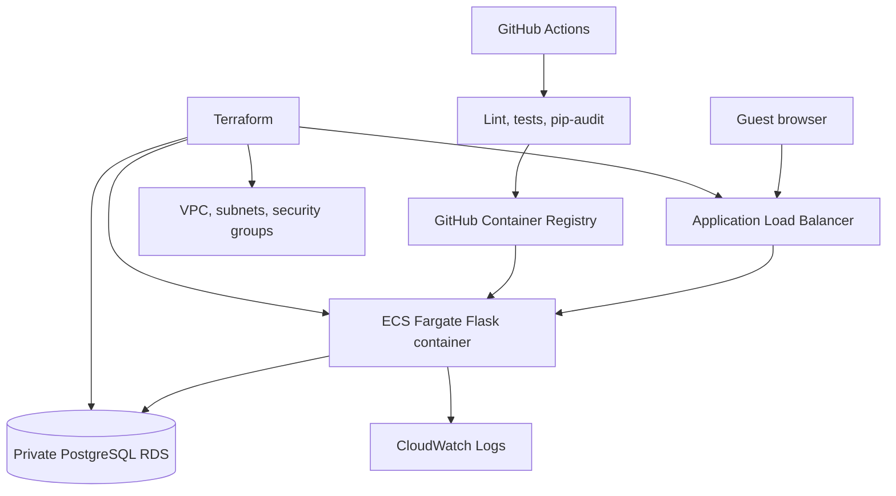

# Architecture

The guest submits a booking enquiry to the Flask API. The API validates dates, guest count, and email before writing to PostgreSQL. The application is containerized; GitHub Actions runs quality gates before publishing a commit-tagged image. Terraform defines the AWS network, load balancer, ECS service, database, IAM execution role, and CloudWatch log group.
